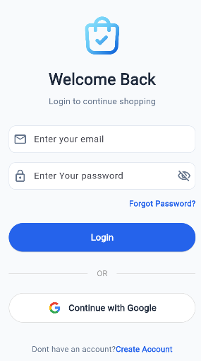
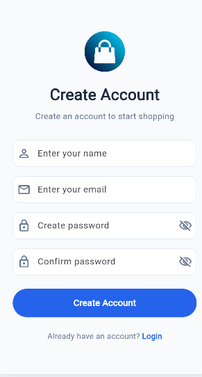
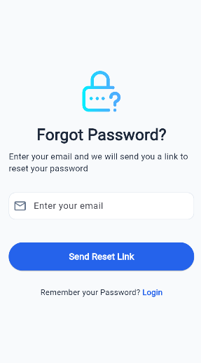
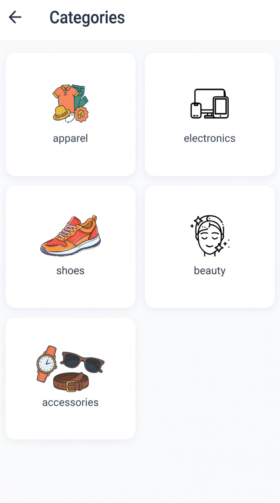
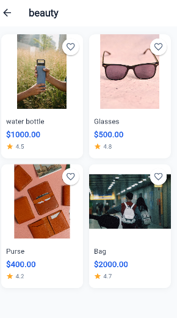

# 🛒 Shopping App (Flutter E-Commerce Application)

A modern, clean, and feature-rich E-Commerce mobile application built using **Flutter** and **MVVM Architecture**. The app provides a seamless shopping experience with user authentication, category browsing, product listings, and a responsive UI.

---

## 📱 App Screenshots

Here are the visual previews of the application:

| Login Screen | Register / Sign Up | Forgot Password |
| :---: | :---: | :---: |
|  |  |  |

| Home Screen | Categories Screen | Specific Category |
| :---: | :---: | :---: |
|  |  |  |

---

## ✨ Features

- **🔐 Authentication & User Management:**
  - Login with Email & Password
  - Google Sign-In Integration
  - New User Registration / Sign-Up
  - Password Reset Request

- **🛍️ E-Commerce & Browsing:**
  - Dynamic Home Screen with promo banners & search
  - Flash Sale product section
  - Category-based product filtering (Apparel, Electronics, Shoes, Beauty, Accessories)
  - Detailed product grid with ratings & wishlist functionality

- **🏗️ Architecture & Code Quality:**
  - Feature-first folder structure
  - Clean MVVM (Model-View-ViewModel) pattern separation
  - Centralized routing, themes, constants, and utilities

---

## 📁 Project Structure

```text
lib/
├── core/                  # Shared utilities, theme, constants & routes
│   ├── constant/
│   ├── routes/
│   ├── theme/
│   ├── utils/
│   └── widgets/
├── data/                  # Data layer (APIs, repositories & services)
│   ├── repositories/
│   └── services/
└── features/              # Feature modules (MVVM pattern)
    ├── auth/              # Login, Register & Reset Password
    │   ├── models/
    │   ├── viewmodels/
    │   ├── views/
    │   └── widgets/
    ├── home/              # Dashboard & Main Feed
    │   ├── models/
    │   ├── viewmodels/
    │   ├── views/
    │   └── widgets/
    └── product/           # Categories & Product Listing
        ├── models/
        ├── viewmodels/
        ├── views/
        └── widgets/